# Sofle Choc Pro: ZMK config

**Firmware:** [download the latest build](https://github.com/DmitrF/zmk-config/releases/latest). Flash the `left`
file to the left half and the `right` file to the right half (`settings_reset`
only to wipe settings and Bluetooth pairings).

The picture is redrawn by the `Draw keymap` GitHub Action whenever the keymap changes.
Labels for macros and the Cyrillic letters on the `ua`/`ru` layers are set in
`keymap-drawer/config.yaml` and `keymap-drawer/cyrillic.py`.

## Karabiner-Elements (macOS)

`karabiner/karabiner.json` goes to `~/.config/karabiner/karabiner.json`. Besides
switching input sources on `LANG1`/`LANG2`/`LANG3` from the Sofle, it makes the
MacBook's built-in keyboard (vendor 1452, product 834) behave like the Sofle
`nav` layer while `right_command` is held: same keys, same actions (IJKL arrows,
H ⌫, Y ⌦, U/O line start/end, ESDF/WR/XV selection, Q select word, N delete line).
These rules only apply to the built-in keyboard, so the Sofle's own ⌘ shortcuts
are left alone.

The Sofle `nav` layer has since been reworked (select, mouse and window
sub-layers), so these MacBook rules still follow the older layout; syncing them
is an open task in [`docs/plan.md`](docs/plan.md).
